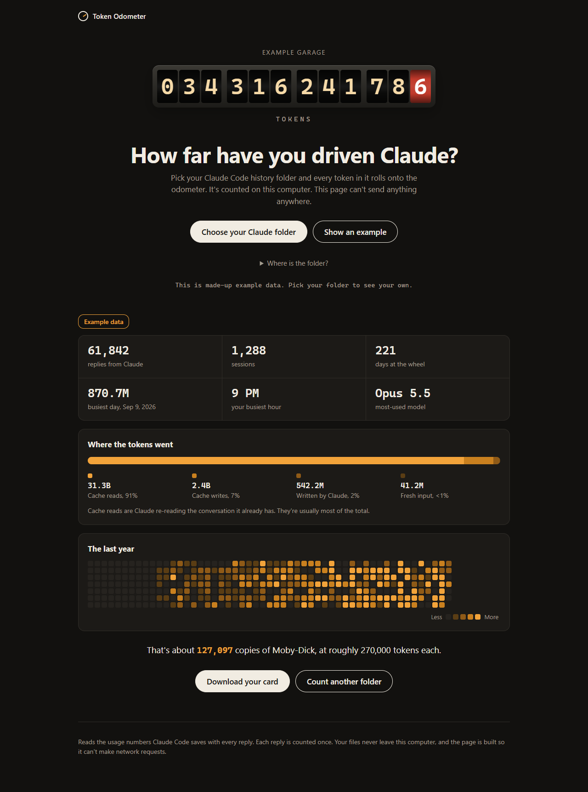

# Token Odometer

See how many tokens you've pushed through Claude Code, counted on your own computer. Pick your
`~/.claude/projects` folder and get a rolling odometer, totals by kind, a year heatmap and a share card.

**Live:** https://token-odometer.vercel.app



## How it works

- **Counting** (`worker.js`): a Web Worker reads every transcript and counts each reply once by `message.id`.
  Claude Code writes one line per content block with the same usage repeated, so counting lines overcounts by up
  to five times.
- **Nothing leaves the page, and that's enforced:** the Content-Security-Policy in `vercel.json` sets
  `connect-src 'none'`, and `tools/test_live.js` proves a fetch from the live site is blocked.
- **Checked against a second counter:** `tools/test.js` compares the app's totals with an independent Python
  counter (`tools/reference_count.py`) on a fixed set of transcripts.

## Stack

Plain HTML, CSS and JavaScript. No build step.

## Running it

Serve the folder with any static server (for example `npx serve .`) and open it. The tests need Node and a folder
of sample transcripts in `tools/fixture/`:

```bash
cd tools && npm install && node test.js
```
